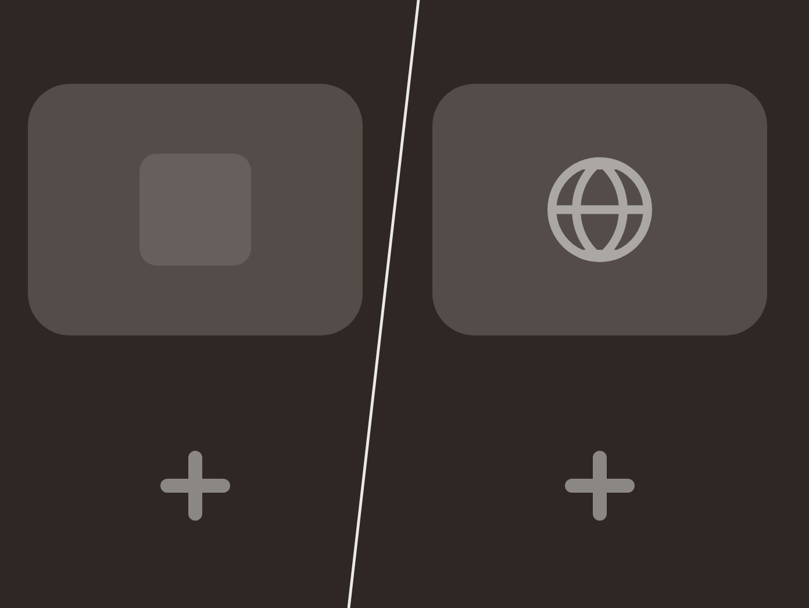

# Tab Loading Icon

Replaces the empty tab icon while a page is loading with a smooth Material-style spinner.

While a page is loading and has no favicon yet, [Zen Browser](https://zen-browser.app/) shows a blank placeholder in the tab. This mod swaps it for an animated spinner whose arc grows, shrinks and rotates, like the circular progress indicator in Material Design.

---

Thumbnail

---

## Settings

- **Spinner color**: *Light* (default, for dark themes) or *Dark* (for light themes).

## Installation

### Zen Mods (recommended)

1. Open Zen settings → **Zen Mods**.
2. Find **Tab Loading Icon** and click **Install**.
3. Restart Zen if the spinner doesn't appear right away.

### Manual

1. Open `about:config` and set `toolkit.legacyUserProfileCustomizations.stylesheets` to `true`.
2. Open `about:support` and click **Open Folder** next to **Profile Folder**.
3. Create a `chrome` folder in it if it doesn't exist.
4. Copy the contents of [`chrome.css`](chrome.css) into `chrome/userChrome.css`. Create the file if needed.
5. Restart Zen completely.

If nothing changes, clear the startup cache: `about:support` → **Clear startup cache**.

## Customization

Everything is inside [`chrome.css`](chrome.css):

- **Speed**: change `1.4s` (it appears twice in each SVG; keep both values equal).
- **Thickness**: change `stroke-width='6'`.
- **Size**: change `width` and `height` (default `16px`).
- **Custom color**: change `stroke='%23e3e3e3'`. `%23` stands for `#`, so `%23ff8800` means `#ff8800`.

## Changelog

Version 1.0.0

- First release.

## License

[MIT](LICENSE)
